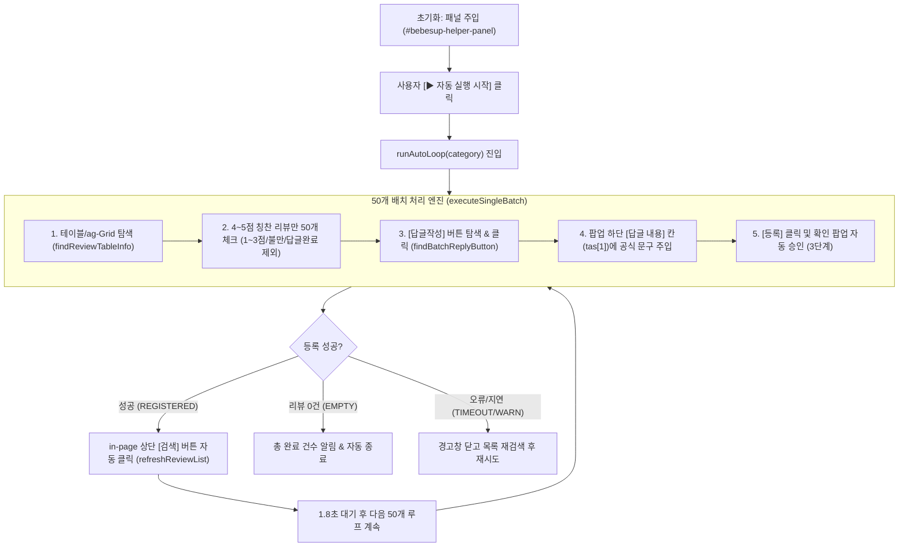

# 🛠️ [베베숲 AI 리뷰 자동화] 개발자 인수인계 & 오류 개선 핸드북

> **작성일**: 2026-11-13  
> **대상자**: 휴무자 대체 근무자, 유지보수 개발자, 다른 PC 작업자  
> **목적**: 다른 컴퓨터나 다른 작업자가 프로젝트를 즉시 인계받아 실행, 디버깅, 네이버 UI 변경 대응, 오류 개선을 막힘없이 수행할 수 있도록 작성된 기술 인수인계서입니다.

---

## 📌 1. 프로젝트 파일 위치 및 동기화 규칙 (CRITICAL)

본 프로젝트는 현재 PC 내 두 경로에 동일하게 배치되어 관리되고 있습니다.

| 경로 | 역할 | 비고 |
| :--- | :--- | :--- |
| `D:\dev\리뷰\bebesup_extension\` | **개발 원본 소스 코드** | 코드 수정 작업 진행 위치 |
| `D:\bebesup_extension\` | **실제 크롬에 로드된 확장 프로그램** | 브라우저가 직접 읽고 실행하는 위치 |
| `D:\dev\리뷰\bebesup_extension.zip` | 개발 폴더 백업 압축본 | 타 PC 이동용 패키지 |
| `D:\bebesup_extension.zip` | 배포용 최종 압축본 | 타 PC 이동용 패키지 |

> ⚠️ **수정 시 필수 주의사항**:
> `D:\dev\리뷰\bebesup_extension\content.js`를 수정하셨다면, 반드시 **`D:\bebesup_extension\content.js`에도 복사(동기화)**하고 **압축파일(`.zip`)을 재빌드**해야 합니다. (동기화 원클릭 명령어는 하단 5장 참조)

---

## 💻 2. 다른 컴퓨터(새 PC)에서 3분 만에 세팅하는 법

새로운 작업자나 다른 컴퓨터에서 작업할 때는 다음 순서대로 진행합니다.

1. **파일 복사**:
   - `bebesup_extension.zip` 파일을 USB나 사내 드라이브를 통해 새 컴퓨터의 `D:\` 또는 원하는 폴더에 압축 해제합니다. (예: `C:\bebesup_extension` 또는 `D:\bebesup_extension`)
2. **크롬 확장 프로그램 등록**:
   - 크롬 브라우저를 열고 주소창에 `chrome://extensions` 입력 후 엔터.
   - 우측 상단의 **[개발자 모드]** 토글을 켭니다.
   - 좌측 상단의 **[압축해제된 확장 프로그램을 로드합니다.]** 버튼 클릭 ➔ 압축을 푼 `bebesup_extension` 폴더 선택.
3. **네이버 스마트스토어 접속**:
   - `https://sell.smartstore.naver.com/#/review` (스마트스토어 리뷰 관리) 접속.
   - 페이지 상단에 초록색 테두리의 **[🌿 베베숲 AI 리뷰 자동화 어시스턴트]** 패널이 나타나면 준비 완료!

---

## 🧩 3. 코드 아키텍처 및 핵심 파일 분석 (`content.js`)

확장 프로그램의 모든 핵심 기능은 `content.js` 단일 파일에 모듈화되어 있으며, 외부 라이브러리 없이 순수 바닐라 JS로 작성되었습니다.



### 핵심 함수 목록 & 역할 (코드 내 위치)

| 함수명 | 설명 및 주의사항 |
| :--- | :--- |
| `findSearchButton(doc)` | 스마트스토어 상단의 초록색 **[검색]** 버튼을 iframe 내부까지 탐색하여 반환. |
| `refreshReviewList(doc)` | 전체 새로고침 없이 상단 [검색]을 클릭하고 1.8초 대기하여 다음 50건을 불러오는 AJAX 갱신 함수. |
| `findReviewTableInfo()` | ag-Grid 또는 일반 HTML Table 중 현재 화면에 렌더링된 리뷰 테이블과 행(rows) 목록을 추출. |
| `findBatchReplyButton(doc, table)` | 선택된 50개 리뷰에 답글을 달기 위한 상단 툴바의 **[답글작성]** 버튼을 정밀 탐색. |
| `findReplyModalInfo(doc)` | 답글 모달 내 2개의 textarea 중 **첫 번째(글번호)를 피하고 두 번째(답글 내용) textarea**를 정확히 반환. |
| `executeSingleBatch(category, mode)` | 50개 리뷰 필터링 ➔ 체크 ➔ 모달 오픈 ➔ 텍스트 입력 ➔ 등록 ➔ 확인 팝업 승인까지 1회 완결. |
| `runAutoLoop(category)` | 전체 페이지 새로고침 없이 in-page로 50개씩 끝까지 무중단 연속 처리하는 최상위 루프. |

---

## 🛡️ 4. 안전 필터링 규칙 (절대 훼손 금지)

고객 클레임 및 2차 VOC 방지를 위해 아래 필터는 엄격하게 유지되어야 합니다.

1. **평점 필터**:
   - 별점 **1~2점은 무조건 제외 (0건 자동 처리)**: 극단 저평점 및 긴급 안전 클레임으로 CS 전담팀 수동 유선 대응.
   - 별점 **3점**: **불만어가 없는 평이하고 괜찮은 리뷰는 답글 등록 대상에 포함**, 애매한 불만/아쉬운 소리(마름, 헐거움, 작음 등)가 섞인 건은 `badWords` 필터에서 자동 제외.
   - 별점 **4~5점**: 불만어 없는 칭찬 리뷰 전원 자동 답글 등록 대상.
2. **불만/주의/결함 키워드 (`badWords` 배열)**:
   - 캡/뚜껑 헐거움, 마름/물기부족, 파손/찢어짐, 악취/곰팡이/먼지/오염, 발진/두드러기/알레르기/아토피, 가격비쌈/돈아깝 등 100여 개 키워드 포함 시 자동 제외.
3. **카테고리별 3대 공식 문구**:
   - 물티슈/전라인 공통, 스킨케어, 세탁세제 각각 지정된 멘트 자동 적용.

---

## 🚨 5. 주요 오류 해결 이력 및 긴급 트러블슈팅 (Runbook)

다른 컴퓨터나 추후 발생할 수 있는 이상 현상에 대한 조치 방법입니다.

### Q1. "작업하다가 중간에 멈춰요!" (가장 중요)
- **원인**: 과거 버전에서 50개 등록 후 `location.reload()`(새로고침)를 호출했는데, 스마트스토어는 새로고침 시 검색 버튼을 누르기 전까지 테이블을 빈 상태(0개)로 둡니다. 이 때문에 대기하다 타임아웃된 것입니다.
- **해결책**:
  - 최신 `content.js`는 새로고침 대신 **`refreshReviewList()`(상단 [검색] 버튼 자동 클릭)** 방식을 사용하므로 멈추지 않습니다.
  - 혹시라도 멈춘다면 스마트스토어 상단의 초록색 **[검색]** 버튼 텍스트나 DOM 위치가 네이버 개편으로 바뀌었는지 `findSearchButton()`을 확인하세요.

### Q2. "답글 내용이 '리뷰 글번호' 칸에 들어가거나 엉뚱한 곳에 적혀요!"
- **원인**: 스마트스토어 답글 모달창에는 상단에 `[리뷰 글번호]` (textarea 1개), 하단에 `[답글 내용]` (textarea 1개) 총 2개의 textarea가 존재합니다.
- **해결책**:
  - `findReplyModalInfo()` 함수에서 반드시 `tas.length >= 2`를 확인하고, **`tas[1]` (또는 `tas[tas.length - 1]`)**을 선택하도록 구현되어 있습니다. 첫 번째(`tas[0]`)를 가져오지 않도록 주의하세요.

### Q3. "이미 답글을 작성한 리뷰라는 네이버 팝업이 떠요!"
- **원인**: 화면에 이미 답글이 달린 리뷰(`답글보기`, 셀 값 `Y`)가 체크박스에 섞여 들어갔을 때 발생합니다.
- **해결책**:
  - 행(Row) 텍스트에 `답글보기`, `답글수정`, `답글완료`, `등록완료`, ` Y `가 포함된 행은 체크하지 않고 건너뜁니다(`skippedAnswered++`).
  - 혹시 팝업이 뜨더라도 `ALREADY_ANSWERED_WARN` 상태로 감지되어 팝업을 자동 닫고 다음 목록을 재조회합니다.

### Q4. "상태: NO_BUTTON 오류가 떠요!"
- **원인**: 체크박스는 체크되었으나 [답글작성] 버튼을 찾지 못한 경우입니다.
- **해결책**:
  - 네이버 스마트스토어의 리뷰 목록 툴바 클래스(`div[class*='toolbar']`, `div[class*='btn_group']`)를 검사합니다.
  - `findBatchReplyButton()`에 새로운 버튼 클래스나 위치를 추가해 주면 해결됩니다.

---

## ⚡ 6. 코드 수정 후 필수 동기화 명령어 (PowerShell)

코드를 수정했거나 다른 컴퓨터로 이동할 때는 아래 명령어를 PowerShell에 복사하여 붙여넣으면 **문법 검사 + 파일 동기화 + zip 압축이 1초 만에 일괄 처리**됩니다.

```powershell
# D:\dev\리뷰 폴더에서 실행:
Copy-Item -Path 'D:\dev\리뷰\bebesup_extension\content.js' -Destination 'D:\bebesup_extension\content.js' -Force
Compress-Archive -Path 'D:\dev\리뷰\bebesup_extension\*' -DestinationPath 'D:\dev\리뷰\bebesup_extension.zip' -Force
Copy-Item -Path 'D:\dev\리뷰\bebesup_extension.zip' -Destination 'D:\bebesup_extension.zip' -Force
node -c 'D:\dev\리뷰\bebesup_extension\content.js'
Write-Host "✅ [동기화 완료] 문법 검사 통과 및 ZIP 패키징이 완료되었습니다!" -ForegroundColor Green
```

---

## 📞 7. 인수인계 체크리스트 (근무 시작 시 확인)

- [ ] 크롬 `chrome://extensions`에서 베베숲 확장 프로그램이 켜져 있는지 확인
- [ ] 스마트스토어 리뷰 관리 페이지 접속 시 우측 상단에 초록색 베베숲 패널이 뜨는지 확인
- [ ] 상단 필터를 `[답글여부: 미등록]`으로 설정 후 초록색 `[검색]` 클릭
- [ ] 베베숲 패널에서 `[⚡ 1회 5개만 등록]` 모드로 5개 먼저 정상 등록되는지 테스트 확인
- [ ] 정상 동작 확인 후 `[🚀 전자동 연속 실행]`으로 변경하고 `[▶ 자동 실행 시작]` 클릭
- [ ] 실시간으로 `[⏹ 자동실행 중지 (누적 50건)]`, `[누적 100건]` 카운터가 올라가며 완주되는지 모니터링
