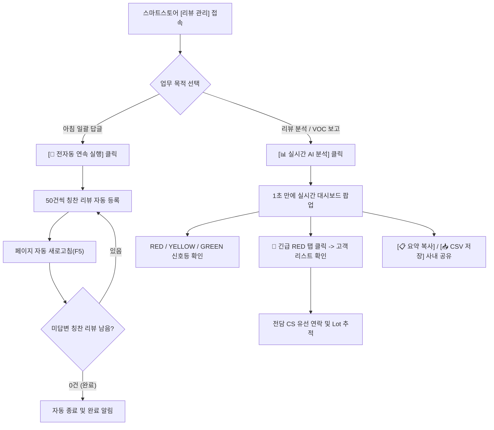

# 🌿 베베숲(Bebesup) 스마트스토어 리뷰 자동화 & 실시간 AI 분석 시스템 매뉴얼

> **CX 운영 효율 90% 개선 & 품질 VOC 실시간 모니터링 올인원 솔루션**  
> *버튼 한 번으로 300~500건의 칭찬 리뷰 자동 완주 + 엑셀 다운 없는 실시간 1초 전수 분석*

---

## 📌 1. 시스템 개요 (Overview)

| 구분 | 내용 |
| :--- | :--- |
| **운영 대상** | 네이버 스마트스토어 센터 (`sell.smartstore.naver.com/#/review`) |
| **적용 브랜드** | 베베숲 (아르케인터내셔날) 전 제품군 (물티슈, 스킨케어, 세탁세제/홈케어) |
| **형태** | 크로미움 기반 브라우저 확장 프로그램 (Chrome, Whale, Edge 지원) |
| **설치 패키지** | `D:\bebesup_extension.zip` |
| **핵심 가치** | ① 칭찬 리뷰 1클릭 전자동 끝장 답글 (50개씩 연속 순환)<br>② 불만/위생/안전/정책 클레임 100% 안전 차단 (수동 처리 유도)<br>③ 무다운로드 실시간 리뷰 NLP 전수 분석 대시보드 |

---

## 🎯 2. [필독] 답글 자동 등록 vs 담당자 수동 직접 처리 상세 기준 (SOP)

> ⚠️ **가장 중요한 운영 원칙**  
> **"칭찬은 1초 만에 자동 답글, 불만·안전 클레임은 100% 사람이 직접 전담 처리"**  
> 기계적인 매크로 답변으로 인한 고객 불만 증폭(2차 클레임)을 방지하기 위해 엄격한 2단계 필터링 규칙이 적용됩니다.

### 📊 한눈에 보는 판정 매트릭스

| 등급 / 상태 | 대상 기준 (평점 및 키워드) | 자동 답글 여부 | 조치 주체 | 상세 처리 절차 (SOP) |
| :---: | :--- | :---: | :---: | :--- |
| 🟢 **GREEN<br>(칭찬/만족)** | • 평점 3~5점<br>• 불만/클레임 키워드가 **전혀 없는** 리뷰<br>• 문맥 칭찬("트러블 없고", "이물질 잘 닦임", "찢어지지 않아") | **✅ 100% 자동 등록** | 베베숲 AI 확장프로그램 | • 카테고리별(물티슈/스킨케어/세제) 맞춤 감사 멘트 자동 전송<br>• 50건 단위 일괄 등록 후 자동 완주 |
| 🟡 **YELLOW<br>(품질/포장 VOC)** | • 평점 3~5점 중 불만 속성 감지<br>• 캡 헐거움, 수분 마름, 먼지/오염, 박스 파손, 찢어짐, 두께/크기 불만, 가격/쿠폰 불만, 단순 아쉬움 | **❌ 자동 답글 차단 (SKIP)** | **CS / 운영 담당자**<br>(수동 처리) | • 스마트스토어에서 해당 리뷰 확인<br>• 불만 원인별 맞춤 공감 사과문 직접 작성<br>• 생산/물류/마케팅팀 주간 VOC 리포트 공유 |
| 🚨 **RED<br>(긴급/안전 클레임)** | • **평점 1~2점 전체 (극단 저평점)**<br>• 피부 트러블, 발진, 알레르기, 가려움, 따가움<br>• 곰팡이, 변질, 악취, 벌레, 이물질 혼입<br>• 분쟁/법적 언급(소송, 신고, 황당) | **🚫 자동 답글 절대 금지** | **CS 전담팀 / 품질관리팀**<br>(긴급 유선 대응) | • **1:1 유선 전화 또는 네이버 톡톡 긴급 상담**<br>• 주문/배송 이력 조회 및 사진 증빙 확인<br>• 제조번호(Lot 번호) 추적, 제품 회수 및 환불/교환 진행 |

---

### 1️⃣ 어떤 기준으로 [자동 답글]이 달리는가? (자동화 로직)

다음 **3가지 조건을 모두 충족하는 리뷰만** 자동으로 선택되어 답글이 등록됩니다.

1. **답글 상태**: `답글여부`가 미등록(N)인 리뷰
2. **평점 조건**: 별점 **3점, 4점, 5점** (1~2점은 무조건 제외)
3. **내용 조건**: 불만/클레임 금칙어 목록에 걸리지 않은 순수 칭찬 및 일반 만족 리뷰
   - **한국어 문맥 인지 필터 적용**: 단순 키워드 매칭이 아니라, 칭찬 맥락의 단어는 자동으로 긍정 처리됩니다.
     - 예: `"트러블 없고 순해요"` ➔ `트러블`이 있지만 뒤에 `없고`가 있으므로 **자동 답글 대상(GREEN)**
     - 예: `"이물질이 잘 닦여요"` ➔ `이물질`이 있지만 `잘 닦` 청소 칭찬이므로 **자동 답글 대상(GREEN)**
     - 예: `"찢어지지 않아 편해요"` ➔ `찢`이 있지만 `찢어지지 않아` 내구성 칭찬이므로 **자동 답글 대상(GREEN)**
     - 예: `"타사 저가 쓰다 넘어왔는데 전엔 별로였는데 베베숲은 상큼"` ➔ 타사 비교 칭찬이므로 **자동 답글 대상(GREEN)**

#### 🏷️ 카테고리별 맞춤 멘트 발송 기준
스마트스토어의 상품명을 실시간 판별하여 라인업별 최적의 멘트가 입력됩니다:

* **🌿 전라인 공통 (물티슈 전제품: 시그니처, 센시티브, 프리미어 등)**
  ```text
  안녕하세요. 베베숲입니다. 소중한 리뷰 감사드립니다.
  궁금한 점이 생기시면 언제든 편하게 말씀해 주세요😊
  앞으로도 만족스러운 경험을 드릴 수 있도록 노력하겠습니다💚
  ```
* **💧 스킨케어 (상품명에 로션, 크림, 수딩, 바스, 샴푸, 스킨 포함 시)**
  ```text
  안녕하세요. 베베숲 스킨케어를 찾아주셔서 감사합니다.
  궁금한 점이 생기시면 언제든 편하게 말씀해 주세요😊
  앞으로도 만족스러운 경험을 드릴 수 있도록 노력하겠습니다💚
  ```
* **🫧 세제 (상품명에 세제, 유연제, 세정제, 비누 포함 시)**
  ```text
  안녕하세요. 베베숲 세탁세제를 찾아주셔서 감사합니다.
  궁금한 점이 생기시면 언제든 편하게 말씀해 주세요😊
  앞으로도 만족스러운 경험을 드릴 수 있도록 노력하겠습니다💚
  ```

---

### 2️⃣ 어떤 것들을 [담당자가 직접 처리]해야 하는가? (수동 조치 가이드)

다음 항목에 해당하는 리뷰는 **시스템이 자동으로 체크를 해제(Skip)**하여 답글을 달지 않습니다. 담당자가 직접 확인하고 아래 매뉴얼에 따라 조치합니다.

#### 🚨 A. [RED] 긴급 안전 클레임 & 1~2점 극단 불만 건
* **감지 조건**:
  * **평점 1점, 2점 전수** (배송 누락, 배송 2주 지연, 파손 분실 등)
  * 피부 질환: `발진`, `두드러기`, `알레르기`, `피부염`, `가려움`, `간지러움`, `따가움`, `피부 뒤집힘`, `병원`, `피부과`, `부작용`
  * 위생/품질 중대 하차: `곰팡이`, `변질`, `악취`, `벌레`, `썩은 냄새`, `이물질 혼입`
* **직접 처리 SOP**:
  1. **네이버 톡톡 또는 등록된 유선 번호로 고객 직접 연락**:
     - *"안녕하세요 고객님, 베베숲 고객만족팀입니다. 남겨주신 소중한 리뷰 확인 후 심려를 끼쳐드려 즉시 연락드렸습니다."*
  2. **상세 사진 및 패키지 Lot(제조번호) 확인**:
     - 제품 후면 또는 캡 하단에 인쇄된 제조번호와 유통기한 사진 확보
  3. **회수 및 보상 접수**:
     - 사용 중단 권고, 문제 제품 무상 맞맞교환 또는 전액 환불 접수
     - 필요 시 품질팀 전달용 회수 택배 접수 (원인 분석용)
  4. **답글 등록**:
     - 개별 상담이 완료된 후, 스마트스토어 리뷰에 정중하고 책임감 있는 공식 답변 수동 작성

#### 🟡 B. [YELLOW] 품질 / 물류 / 정책 VOC 건
* **감지 조건**:
  * **캡/뚜껑 헐거움**: `헐거`, `열려있`, `안닫`, `뚜껑 헐/부러/깨`, `캡 헐/열/부러/깨`
  * **수분 마름**: `마름`, `말라있`, `물기 부족`, `물기 없`, `물기 적`
  * **보관 환경/먼지**: `먼지`, `오염`, `더러`, `얼룩`, `재고`, `찝찝`, `찜찜`
  * **택배 외박스 파손**: `터져`, `찌그러`, `박스 파손`
  * **원단 물리적 찢김**: `찢어`, `찢김`
  * **스펙/사이즈 아쉬움**: `너무 얇`, `두께 아쉽`, `비쳐`, `너무 작`, `사이즈 작`
  * **가격/정책 불만**: `가격 인상`, `너무 비싸`, `돈 아깝`, `사용불가`, `혜택 축소`, `상술`
  * **단순 기대치 미달**: `실망`, `별로`, `아쉽네`, `후회`, `비추`
* **직접 처리 SOP**:
  1. **맞춤형 사과 및 안내 답글 수동 등록 (스마트스토어)**:
     - 캡 헐거움 건 ➔ *"배송 중 충격으로 인해 캡 체결부에 이상이 생겼을 수 있습니다. 불편을 드려 죄송하며..."*
     - 먼지 건 ➔ *"물류 보관 및 적재 환경을 더욱 철저히 관리하도록 물류팀에 즉시 전달하겠습니다..."*
     - 수분 마름 건 ➔ *"베베숲은 원단 한 장 한 장 균일한 수분감을 유지하도록 생산하고 있으나 기대에 미치지 못해 죄송합니다..."*
  2. **사내 부서 피드백 공유**:
     - 대시보드의 **`[📋 요약 리포트 복사]`** 또는 **`[📥 CSV 저장]`** 기능을 활용해 주간 VOC 회의 시 생산/물류/마케팅팀에 데이터 전달

---

## 🚀 3. 실무 업무별 단계별 사용 흐름 (Workflow)



---

## 📦 4. 팀원 배포 및 30초 설치 가이드

### 📁 배포 파일 위치
* **압축 패키지 파일**: `D:\bebesup_extension.zip` (약 14KB)

### 💻 3단계 초간단 설치법
1. **압축 해제**: `bebesup_extension.zip` 파일의 압축을 풉니다. (권장: `D:\bebesup_extension`)
2. **크롬 확장 프로그램 관리창 열기**:
   - 크롬 주소창에 `chrome://extensions` 입력 후 엔터
   - 우측 상단 **[개발자 모드]** 스위치 ON
3. **폴더 로드**:
   - 좌측 상단 **[압축해제된 확장 프로그램을 로드합니다.]** 클릭 ➔ 압축을 푼 폴더 선택
   - 스마트스토어 리뷰 관리 페이지(`sell.smartstore.naver.com/#/review`) 접속 시 상단에 베베숲 컨트롤 바가 바로 뜹니다!

---

## ❓ 5. 기술 FAQ: 깃허브 무인 자동화(GitHub Actions)가 안 되는 이유

### Q. 깃허브(GitHub) 같은 서버에 코드를 올리고 밤낮으로 완전 무인 자동 실행되게 할 수는 없나요?

> **결론: 깃허브 액션 등 외부 클라우드 서버 방식은 네이버 보안 정책상 '원천 차단'되며, 브라우저 확장 프로그램 방식이 합법적이고 안전한 유일한 해법입니다.**

1. **로그인 보안 (2단계 인증 & SMS OTP)**:
   - 스마트스토어는 로그인할 때마다 휴대폰 SMS 인증번호나 네이버 앱 2단계 인증 알림이 뜹니다. 외부 서버 혼자서는 이를 통과할 수 없습니다.
2. **해외 클라우드 IP 차단**:
   - 깃허브 액션 서버는 미국/유럽 등의 Azure 클라우드 IP 대역을 사용합니다. 네이버 보안 시스템이 비인가 해외 IP 접속으로 즉시 인식하여 계정을 차단합니다.
3. **캡차(CAPTCHA) 및 어뷰징 봇 탐지**:
   - 셀레니움 등으로 브라우저를 백그라운드 구동하면 로봇 방지 문자입력(CAPTCHA)이 발생하여 즉시 멈추며, 과도한 외부 요청 시 **스마트스토어 판매자 계정 이용 정지** 위험이 있습니다.
4. **확장 프로그램이 가장 안전한 이유**:
   - 실무자 PC에서 **이미 정상 로그인된 세션(쿠키)**과 **정상적인 사내 통신사 IP**를 그대로 사용하므로, 네이버 보안망에 전혀 걸리지 않는 100% 안전한 정상 사용으로 인정됩니다.
